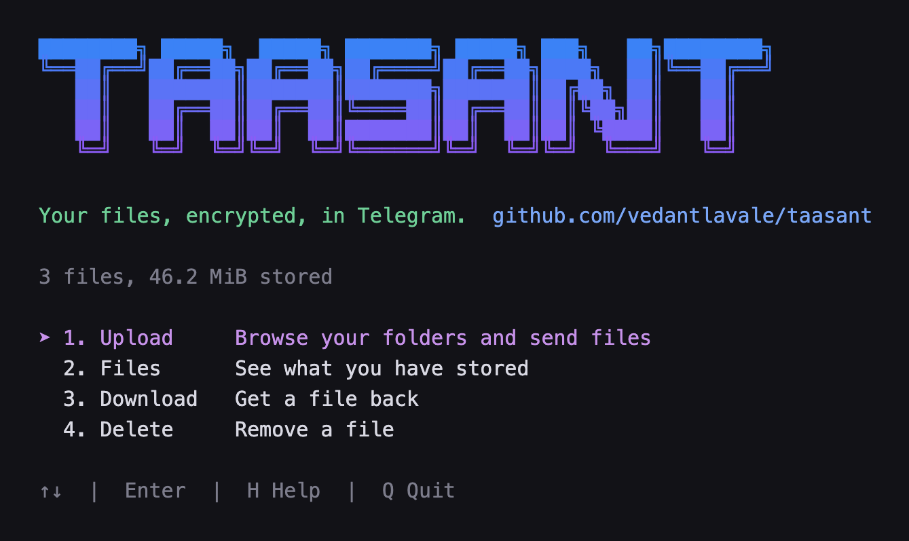
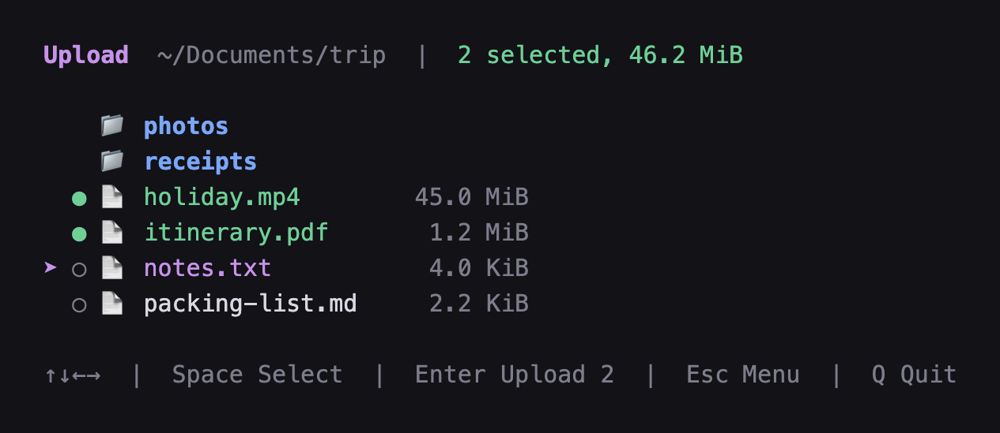
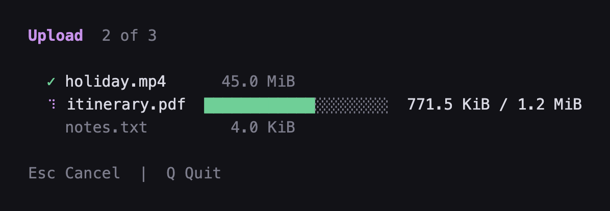
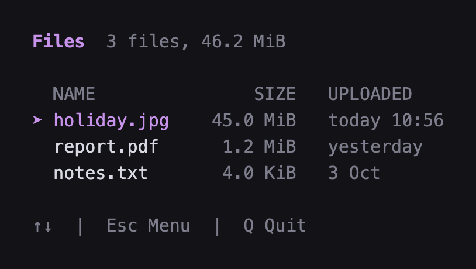

<p align="center">
  
</p>

# taasant

[](https://github.com/vedantlavale/taasant/releases)
[](https://github.com/vedantlavale/taasant/releases/latest)
[](https://github.com/vedantlavale/taasant)

Telegram lets a bot store files in a chat for free. taasant turns that into a little encrypted drive you use from the terminal.

Docs: [taasant.vedantworks.com](https://taasant.vedantworks.com)



Type `taasant` in a folder to get this menu, or use plain commands:

```console
$ taasant upload holiday.jpg
✓ holiday.jpg  45.0 MiB  uploaded in 12.4s

$ taasant list
  NAME               SIZE   UPLOADED
  holiday.jpg    45.0 MiB   today 12:09
  report.pdf      1.2 MiB   yesterday
  notes.txt       4.0 KiB   3 Oct

  3 files, 46.2 MiB

$ taasant download hol
✓ saved holiday.jpg
```

Everything is encrypted on your computer before it is sent, so Telegram only ever sees scrambled bytes. Big files are split up for you, and you get them back by name, not by some long ID.

The code is small. The part that stores files uses nothing outside the standard library, and the menu is built with [Bubble Tea](https://github.com/charmbracelet/bubbletea). It works, but treat it as a hobby project and not as your only backup.

Under its [bot terms](https://telegram.org/tos/bot-developers), Telegram might restrict a bot that is used for storage. To be safe, make the bot from a second Telegram account, and be reasonable about what you store.

## New in version 0.2

- **A menu.** Run `taasant` with nothing after it to browse folders, mark one file or several, and upload, download or delete without typing names.
- **`taasant update`** fetches the newest release and replaces the program in place.
- **Uploads survive a shaky connection.** A broken connection is tried again a few times before taasant gives up.
- **The progress bar moves as bytes go out**, not only when a whole part is done.

## Install

### The quick way (macOS and Linux)

One command downloads the right file and puts it in `/usr/local/bin`. No Go needed.

```bash
curl -fsSL https://taasant.vedantworks.com/install.sh | sh
```

Or do the same by hand. Pick the line for your machine:

```bash
# Apple Silicon Mac
curl -L -o taasant https://github.com/vedantlavale/taasant/releases/latest/download/taasant-macos-arm64

# Intel Mac
curl -L -o taasant https://github.com/vedantlavale/taasant/releases/latest/download/taasant-macos-intel

# Linux
curl -L -o taasant https://github.com/vedantlavale/taasant/releases/latest/download/taasant-linux-amd64
```

Then make it runnable and move it somewhere on your `PATH`:

```bash
chmod +x taasant
sudo mv taasant /usr/local/bin/
taasant keygen
```

If that last command prints a long string of letters and numbers, you're set.

### Updating

From version 0.2 on, run `taasant update`. Version 0.1 does not have that command, so install 0.2 once the same way as above.

On Windows, download `taasant-windows.exe` from the [releases page](https://github.com/vedantlavale/taasant/releases/latest) and run it from a terminal.

### "Apple could not verify taasant is free of malware"

You will see this on a Mac if you download the file with your browser instead of `curl`. Nothing is wrong with the file. Apple shows this for any program whose author hasn't paid for a developer certificate, and I haven't.

Click **Done** (not "Move to Bin"), then tell macOS you trust it:

```bash
xattr -d com.apple.quarantine ~/Downloads/taasant-macos-arm64
```

After that, carry on with the `chmod` and `mv` steps above. You can also go to System Settings → Privacy & Security and press **Open Anyway**.

Downloading with `curl`, as shown above, skips the warning entirely. Also, don't double-click the file: taasant is a terminal program and has no window.

### If you have Go

```bash
go install github.com/vedantlavale/taasant/cmd/taasant@latest
```

Or build it yourself:

```bash
git clone https://github.com/vedantlavale/taasant.git
cd taasant
go build -o taasant ./cmd/taasant
```

You need Go 1.27 or newer.

## Set it up

This takes about five minutes, and you only do it once. Run `taasant` and it asks for what it needs.

**1. Run `taasant`.** The first time, a setup screen opens. The menu comes after it.

**2. Make a bot and paste its token.** Use a spare Telegram account for this if you can. In Telegram, open a chat with [@BotFather](https://t.me/BotFather), send `/newbot`, and answer its two questions. It hands you a token that looks like `123456:ABC...`. Paste it into taasant, which checks it with Telegram.

**3. Choose where the files go.** taasant asks where the bot should keep them:

- **A private channel (recommended).** Your files get a place of their own, away from the bot's chat. In Telegram, create a new private channel, add your bot to it as an administrator (leave its rights switched on, the bot has to post there), and post any message in the channel.
- **The chat with the bot.** Simpler, with nothing else to create. Open your bot in Telegram and press **Start**.

Either way, taasant waits until it hears from that place, shows its name and asks if it is the right one. There is no chat ID to look up. If it found the wrong one, press Esc to look again.

**4. Done.** taasant makes your encryption key, saves everything, and opens the menu.

One warning before you move on. **The key is the only thing that can read your files.** taasant keeps it in its settings file: `~/Library/Application Support/taas/config.json` on a Mac, `~/.config/taas/config.json` on Linux. Put a copy of that file in your password manager. If you lose it, your files are gone for good. Nobody can recover them, including me.

The setup screen is new in version 0.3. On an older version, run `taasant update` first.

### Setting it up by hand

Three environment variables do the same job, and each one that is set wins over the settings file. That is useful in scripts, and a setup made this way before version 0.3 keeps working.

```bash
export TG_BOT_TOKEN="123456:ABC..."
export TG_CHAT_ID="-1001234567890"
export TAAS_KEY="64 hex characters, taasant keygen prints a new one"
```

`TG_CHAT_ID` is the number of the place the files go. For a private channel it is negative and starts with `-100`, as above. For the chat with the bot it is a positive number, your own user ID. The Telegram app does not show either one. The easy way is to let the setup screen find it: run `taasant` once with `TAAS_CONFIG` set to a throwaway path, then read `chat_id` from that file.

## Using it

There are two ways: a menu, and plain commands. Both do the same things.

### The menu

This is the simplest way. Go to the folder your files are in and type `taasant` with nothing after it. Move with the arrow keys and press Enter. The menu stays open until you press Q, and Esc goes back to the start.

**Upload** shows the folder you are in. `→` opens a folder and `←` goes up. Space marks a file, and the marks stay as you move between folders. Enter uploads everything you marked, or the file under the cursor if you marked nothing.



While files are moving there is a line for each one. Esc cancels the ones that have not started.



**Files** shows what you have stored from this computer. A bot cannot ask Telegram what is in the chat, so the list is the one taasant keeps here. **Download** and **Delete** show the same list, and Enter picks the file. A download lands in the folder you started taasant from. Delete asks first.



### Commands

```bash
taasant upload report.pdf          # store a file
taasant list                       # see everything, newest first
taasant list rep                   # search
taasant download report            # get it back
taasant download report copy.pdf   # get it back under another name
taasant delete report              # remove it
taasant update                     # get the newest version of taasant
```

Uploads and downloads show a progress bar that moves as the bytes go out. If the connection drops, taasant tries again a few times before it gives up.

### In scripts

When the output is not a terminal, taasant drops the colours and the progress bar. `upload` then prints only the file's ID, so you can capture it:

```bash
id=$(taasant upload backup.tar)
```

Set `NO_COLOR=1` if you want plain text in a terminal too.

### You don't have to type the whole name

taasant is forgiving about names. `taasant download hol` finds `holiday.jpg`, and so does `taasant download hjp`. It looks for an exact name first, then for names containing what you typed, then for names with those letters in that order.

If more than one file matches, it shows you the matches and does nothing. It will never guess which file you meant to delete.

### It won't overwrite your files

If a file with that name already exists where you are, `download` stops with `file exists`. Give it a different name, as in the `copy.pdf` example above.

## What ends up where

**In your Telegram channel or chat:** your files, as messages with an attachment called `part.bin`. A small file is two messages (the file and a tiny list of its parts). A big one is several. They are encrypted, so opening one from the Telegram app gets you nothing useful. Always use `taasant download`.

**On your computer:** a list of what you have uploaded, called the index. It lives at `~/Library/Application Support/taas/index.json` on a Mac and `~/.config/taas/index.json` on Linux. Set `TAAS_INDEX` if you want it somewhere else.

**A backup of that list:** every time you upload or delete, taasant also sends an encrypted copy of the index to the same place, and notes where it is in a file called `index.json.remote` next to the index. Each backup adds a couple of messages to the channel or chat, so expect some clutter.

## Things worth knowing

- **Lose the key, lose the files.** Yes, this is here twice.
- **Look after the index.** If you lose it, your files are still in the channel or chat, but taasant no longer knows which messages are which. Copying the `taas` folder somewhere safe now and then is enough.
- **You can only delete recent files.** Telegram lets a bot delete messages for 48 hours after sending them. After that, `taasant delete` will fail, and you would have to remove the messages by hand in the app.
- **Big files need memory.** Files are handled in 19 MiB parts and several are in memory at once. A very large download can use a lot, because all its parts are fetched together.
- **Use a second Telegram account for the bot.** Telegram might restrict a bot that is used for storage, so keep your main account out of it.
- **One computer.** The index is not synced. If you use taasant on two machines, each has its own list.

## When something goes wrong

**`there is no bot token, run "taasant" in a terminal to set up`**
taasant has not been set up on this computer. Run `taasant` with nothing after it and answer its questions.

**`the bot can't send messages to the bot`**
Your `TG_CHAT_ID` is a bot's ID. This usually means you used the number at the start of the token. Use the number @userinfobot gave you, or let the setup screen find the place for you.

**Setup keeps waiting after you added the bot to a channel**
taasant listens for the bot being added to a channel and for new posts there, and it hears nothing from before it started. Make sure the bot is an administrator of that channel, with its rights on, and post a new message in the channel. If you chose the chat with the bot instead, press **Start** in it.

**`chat not found`, or `bot is not a member of the channel chat`**
The `TG_CHAT_ID` is wrong, or the bot is no longer in the channel. For a channel the number starts with `-100`. Add the bot to the channel as an administrator again, or run setup again.

**`bot can't initiate conversation with a user`**
The bot may not write to you until you have written to it. Open your bot in Telegram and press Start.

**`401 Unauthorized`**
The token is wrong or has been revoked. Get a fresh one from @BotFather.

**`cipher: message authentication failed`**
The key in use is not the key this file was uploaded with. Check whether `TAAS_KEY` is set and differs from the key in the settings file.

**`the key must be 64 hex characters`**
The key is missing or got cut off when it was pasted. If you set `TAAS_KEY` yourself, check `echo $TAAS_KEY`.

**`file exists`**
`download` won't overwrite. Give it another output name.

## How it works, briefly

A bot can upload files up to 50 MB but can only download ones up to 20 MB, so taasant cuts every file into 19 MiB parts. Each part is encrypted with AES-256-GCM and sent as its own message. Then it sends one more small encrypted file, the manifest, which lists the parts in order. The manifest's ID is what gets saved in your index next to the file name.

Downloading does the reverse: look up the name, fetch the manifest, fetch the parts, decrypt them, and write them out in order.

## Working on the code

```bash
go test ./...          # no token or internet needed, it uses a fake Telegram
go test -race ./...    # also checks for concurrency mistakes
```

`cmd/taasant/` is the command line and the index. `tgstore/` does the splitting, the encryption and the talking to Telegram.

## Credits

The storage design was inspired by [golang-design/tgstore](https://github.com/golang-design/tgstore).

## License

[MIT](LICENSE). Use it, change it and share it freely; keep the copyright notice.
